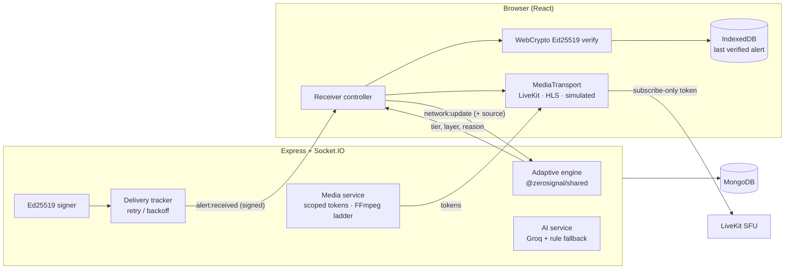

# ZeroSignal

**When networks fail, information shouldn't.**

ZeroSignal is adaptive emergency broadcasting for unreliable networks. A broadcaster sends one alert; every receiver gets the richest version its own link can carry: 720p video, 480p, 240p, audio only, compact signed text under 1 KB, and, when the link is gone, the last verified alert cached on the device.

React + Vite + Tailwind client · Node + Express + Socket.IO server · MongoDB · Groq for AI (backend only) · LiveKit / HLS for real media (optional).

---

## Quick start (local)

Requires Node 20+ and a MongoDB database (Atlas free tier is fine).

```bash
npm install
cp server/.env.example server/.env        # fill in MONGODB_URI; leave the rest blank for local dev
npm run admin:create -- --email=you@example.org --name="Your Name"   # prints a one-time setup link
npm run dev                                # API on :5000, client on :5173
```

Open http://localhost:5173 and sign in. In development the setup link is also printed in the server log (`MAIL_TRANSPORT=console`).

### Optional: pre-loaded sample history

For local development and showcase deployments you can pre-load a week of realistic history (broadcasts, alerts, metrics, tier changes, deliveries and eight people), so the dashboards are not empty on first look:

```bash
# in server/.env:  SEED_EMAIL_DOMAIN=responders.example.org   (SEED_USER_PASSWORD optional)
npm run seed          # idempotent; prints a generated password ONCE and writes SEED_CREDENTIALS.local.md (git-ignored)
npm run seed:clean    # removes exactly what the seed created, nothing else
```

- Seeding is **command-line only**. There is no seed, reset or sample-data control anywhere in the app, and no API route for it.
- It refuses to run when `NODE_ENV=production` unless you pass `--force-production`.
- Seeded records look like any other: nothing in the UI or the API says "demo", "sample" or "test". Provenance is tracked in a hidden field (`seedBatchId`, never returned by a query) so `seed:clean` can find it.
- It never takes over a real account that uses a seeded email address.
- Sample history is pre-loaded for local/dev and showcase deployments. Production deployments start empty.

Without `GROQ_API_KEY` everything still works: AI steps fall back to labelled rule-based classification. In development a built-in dev `JWT_SECRET` and signing seed are used if you leave them blank; production refuses to start without real ones.

### Commands

| Command | What it does |
|---|---|
| `npm run dev` | server (`node --watch`) and Vite client together |
| `npm run admin:create -- --email=… --name="…"` | create the first admin; prints a one-time setup link |
| `npm run seed` / `npm run seed:clean` | pre-load / remove the sample history (CLI only) |
| `npm run media:hls` | verify the HLS ladder with the real FFmpeg (about 12 s) |
| `npm test` | shared, server and client test suites |
| `npm run build` | production client build (`client/dist`) |
| `npm start` | production API |

## Accounts and sessions

- **Receivers** register themselves (`/register`). **Broadcaster and admin accounts are created by an admin** (Admin → Users) and arrive as a one-time setup link: the admin never picks or sees a password.
- Passwords: argon2id, policy of 10+ characters with a common-password check. Wrong guesses lock the account with exponential back-off (5 failures, then 1 to 30 minutes); responses never reveal whether an email exists. Forgot-password always answers the same way.
- Sessions: a 15-minute access token held **in memory only**, plus a rotating 30-day refresh token in an `httpOnly`, `Secure`, `SameSite=Lax` cookie scoped to `/api/auth`. Reuse of an old refresh token revokes the whole token family. `refresh` and `logout` require a custom header, which blocks cross-site requests.
- Admins and broadcasters can enable TOTP two-factor (authenticator app, 8 one-time backup codes; the secret is encrypted at rest).
- An audit trail (sign-ins, lockouts, role changes, broadcasts started or stopped, alerts sent) is visible to admins and expires after `AUDIT_RETENTION_DAYS`.
- Email (reset and invite links): `MAIL_TRANSPORT=console` prints links to the server log; set `MAIL_TRANSPORT=smtp` and `SMTP_URL` for real email.

## Environment variables

Server (`server/.env`, commented in `server/.env.example`). **All secrets are backend-only.**

| Variable | Required | Purpose |
|---|---|---|
| `MONGODB_URI` | prod | Atlas connection string |
| `JWT_SECRET` | prod | 32+ chars, HS256 access tokens |
| `ALERT_SIGNING_SEED` | prod | 64 hex chars, Ed25519 seed; public key at `/api/alerts/public-key` |
| `CLIENT_ORIGINS` | prod | Comma-separated allowed browser origins |
| `APP_BASE_URL` | no | Where email links point (defaults to first origin) |
| `ACCESS_TOKEN_TTL`, `REFRESH_TTL_DAYS` | no | `15m`, `30` |
| `COOKIE_SAMESITE`, `COOKIE_SECURE` | no | `lax`; Secure defaults on in production |
| `LOCKOUT_*`, `ARGON2_*`, `RESET_TTL_MINUTES`, `INVITE_TTL_HOURS`, `AUDIT_RETENTION_DAYS` | no | See the example file |
| `MAIL_TRANSPORT`, `SMTP_URL`, `MAIL_FROM` | no | `console` or `smtp` |
| `GROQ_API_KEY`, `GROQ_MODEL`, `GROQ_TIMEOUT_MS` | no | Empty key = rule-based fallback |
| `RATE_LIMIT_*`, `TRUST_PROXY` | no | Set `TRUST_PROXY=1` on Render |
| `MEDIA_PROVIDERS`, `MEDIA_ROOM_SALT` | no | Provider fallback order; room-name salt |
| `LIVEKIT_URL`, `LIVEKIT_API_KEY`, `LIVEKIT_API_SECRET`, `LIVEKIT_TOKEN_TTL_SEC` | no | Real WebRTC streaming |
| `FFMPEG_PATH`, `HLS_BASE_URL`, `HLS_OUTPUT_DIR`, `HLS_SOURCE_FILE` | no | HLS ladder |
| `SEED_EMAIL_DOMAIN`, `SEED_USER_PASSWORD` | CLI / boot | Read by `npm run seed` and by `SEED_ON_BOOT` |
| `BOOTSTRAP_ADMIN_EMAIL`, `BOOTSTRAP_ADMIN_NAME` | no | Creates the first admin at boot; setup link goes to the server log |
| `SEED_ON_BOOT` | no | `true` loads the sample history once, on first boot only |

Client (`client/.env.local`): `VITE_API_URL` (empty locally and on Vercel) and `VITE_SOCKET_URL` (empty locally; your Render URL on Vercel). Nothing else belongs in the client.

## Architecture



The adaptive engine, scores, predictor, simulator maths, tier-to-media-layer mapping, compact alert format and geo helpers live in `shared/` and are used by both server (authoritative) and client (display, simulator, payload sizing), so there is one definition of every threshold.

```
zerosignal/
├── shared/    pure logic + tests: engine, scores, predictor, simulator, scenarios, compact format, geo, media layers
├── server/    Express, Socket.IO, Mongoose models, services (accounts, media, AI, signing, delivery, analytics), CLI tools
├── client/    React app: pages, components, receiver controller, media transports, alert cache, service worker
├── docs/      STREAMING.md (providers, limits, manual test plan)
├── render.yaml        Render blueprint for the API
└── client/vercel.json Vercel config for the client
```

### The adaptive engine

| Tier | Entered at | Media layer |
|---|---|---|
| 720p | 8 Mbps and up | 720p |
| 480p | 2 Mbps and up | 480p |
| 240p | 700 Kbps and up | 240p |
| Audio | 200 Kbps and up (holds to 100 Kbps) | audio only |
| Text | below that | none (signed text alert) |
| Cached | offline | none (last verified alert on the device) |

Loss, latency, jitter and instability can demote a tier even when bandwidth looks fine. Hysteresis (two readings to step down, four to step up with 15% headroom, immediate drop for large falls, offline or CRITICAL) stops flapping. A trend predictor switches down ahead of a predicted fall. Every decision carries a plain-language reason (the "Why" panel). CRITICAL alerts are retried with backoff until acknowledged or expired.

## Real vs simulated

| Part | Status |
|---|---|
| Adaptive engine, signatures, translations, delivery retries, analytics, accounts, audit | **Real** |
| Network conditions in the Demo page and simulator presets | **Simulated**, labelled "Simulated" |
| Video | **Real** when LiveKit or HLS is configured; otherwise a **labelled canvas simulation** |
| Engine input | "Measured (real WebRTC stats)" when a real stream is active; "Probe-estimated" in Live Mode; otherwise "Simulated". The label is always shown |
| SMS fallback and mesh relay | **Simulated**, labelled everywhere. There is no carrier or radio |
| HLS test pattern | **Generated by FFmpeg**, labelled "Test pattern" (not a camera) |

See [docs/STREAMING.md](docs/STREAMING.md) for the streaming model, provider setup, free-tier limits and the manual test plan.

## Demo walkthrough (about 3.5 minutes)

Sign in as a broadcaster or admin, open **Demo**, and press **Auto-pilot** (captions explain each step), or run it by hand:

1. **Start**: four simulated receivers join: A above 8 Mbps (720p), B about 2 Mbps (480p), C 80 Kbps (text), D a healthy neighbour of C.
2. **Degrading** on a receiver: watch 720p → 480p → 240p → audio, with the engine's reason for each switch, including predictive ones.
3. **Critical** on C: the video is gone, the alert persists as compact signed text.
4. **Trigger emergency** (cyclone landfall): a full-screen takeover on receivers, signature verified in the browser; per-receiver delivery in the dashboard.
5. **Translate**: Tamil, Hindi, Telugu, English; "Read aloud" where the device has a voice.
6. **Offline** on C: **Last verified alert**, labelled cached. In its Offline tab, "tamper" is rejected by the signature check.
7. **Analytics**: delivery rate, reactive vs predictive adaptations, tier distribution, incident replay.
8. **Reset** restarts the simulated receivers (it touches no stored data).

For real media: configure LiveKit (or start the HLS test pattern), go live, publish from **Media ingest**, and watch a second browser follow the engine's layer.

Extras: `Ctrl/⌘ K` command palette (includes theme switching), `Alt J` Judge Mode HUD, Light / Dark / System theme (navbar, Settings, palette), easy-read mode, Live Mode (Receiver → Network) to measure the real link.

## Feature checklist

Legend: ✅ working · 🧪 working but simulated (and labelled) · ⚠️ partial · ⏭️ skipped (reason given).

**Phase 1** — all ✅ as before: adaptive engine, priority alerts, Groq with rule fallback, persistence, multi-receiver grid, analytics, multilingual alerts, offline cache, admin, explainability, acknowledgments, replay and report export, command palette, Judge Mode, PWA. 🧪 network simulator, SMS and mesh.

**Phase 2 (MUST)**
- ✅ Light / Dark / System theme: semantic tokens, no flash, saved to localStorage and the account, per-theme `theme-color` and manifest, WCAG AA enforced by a test, charts/map/toasts correct in both, print always light
- ✅ Login cleanup: plain email + password, show/hide, lockout messaging, forgot-password; no shortcuts or credential hints
- ✅ Sample history invisible in the UI and API; CLI-only seeding; provenance hidden
- ✅ Real accounts (see above), admin-created staff accounts, TOTP, audit trail
- ✅ Streaming: `MediaTransport` (simulated / LiveKit / HLS), server-chosen layers, scoped tokens, fallback chain, ingest (camera, mic, screen, looping file), real WebRTC stats into the engine with provenance labels. ⚠️ Verified with mocks and a real FFmpeg ladder; **not** against a live LiveKit server or real throttled browsers (use the manual plan)

**Phase 2 (HIGH and below)** — status is kept current in the final report delivered with each build. Implemented so far: demo hardening (per-session receiver ids; Reset only resets in-memory scenario state; `/demo` is broadcaster/admin only), audit trail for broadcasts and alerts.

## Testing

```bash
npm test
```

- `shared`: engine, scores, predictor, simulator, scenarios, geo, compact format, tier↔layer mapping
- `server`: accounts (lockout, reuse detection, invites, TOTP, reset), auth routes, media (token grants, room naming, signed HLS links, fallback chain, FFmpeg arguments), sockets, security, analytics, seed dataset
- `client`: receiver controller, signatures and cache, replay, demo script, **theme contrast (WCAG AA)**, media transports and fallback session with mocks
- Database suite `server/tests/db.test.js` needs a real MongoDB (`MONGODB_URI_TEST`); it skips with a notice otherwise. It covers seed idempotency, `seed:clean`, hidden provenance, TTL indexes and the Mongo account repositories.

## Deploying

Free-tier, **no shell required**: see **[docs/DEPLOY.md](docs/DEPLOY.md)** for the full walkthrough. In short:

- **Render (API):** Root Directory **empty** (the API needs `shared/`; Render hides files outside the root directory), build `npm ci --omit=dev --workspace=shared --workspace=server`, start `npm start`. Set `BOOTSTRAP_ADMIN_EMAIL` and read the one-time setup link in Render → Logs. Optionally `SEED_ON_BOOT=true` for the sample history.
- **Vercel (client):** Root Directory **`client`**. Put your Render host in `client/vercel.json` (`/api` rewrite) and set `VITE_SOCKET_URL` to the Render URL before building. Leave `VITE_API_URL` unset.
- With a shell you can still use `npm run admin:create` and `npm run seed`.

## Security

Helmet; CORS allowlist with credentials only for allowed origins; JWT pinned to HS256 with role middleware; zod validation on every body, query and socket payload; NoSQL operator stripping; text sanitisation; rate limits (general, auth, AI); refresh rotation with reuse detection; lockout; argon2id; encrypted TOTP secrets; scoped, short-lived media tokens; AI output treated as untrusted; errors never leak internals; secrets live only in the server environment.

## Deviations and honest notes

- **Ed25519 instead of HMAC** for alert signatures, so browsers can verify offline with a public key. Browsers without Ed25519 fall back to `/api/alerts/verify` and otherwise show the alert as *unverified*.
- **Receivers' tier is decided on the server** from the metrics they report. The numbers themselves come from the client, so a hostile client could misreport; the label says where they came from.
- **Live Mode packet loss** is the share of failed probe requests, not true packet loss.
- **DB-dependent code** (Mongo account repositories, seed runner, TTL indexes) could not be executed in the build sandbox (no MongoDB available); it is covered by `db.test.js`, which runs against your database.
- **Video recording is not implemented** (LiveKit egress needs a paid or self-hosted service).

## Known limitations

- The map is a stylised plot, not tiles.
- Browser speech voices vary; Tamil and Telugu are often missing, and the UI says when a language has no voice.
- Free-tier cold starts add up to a minute to the first request.
- LiveKit's free tier caps at 5,000 participant-minutes a month.
